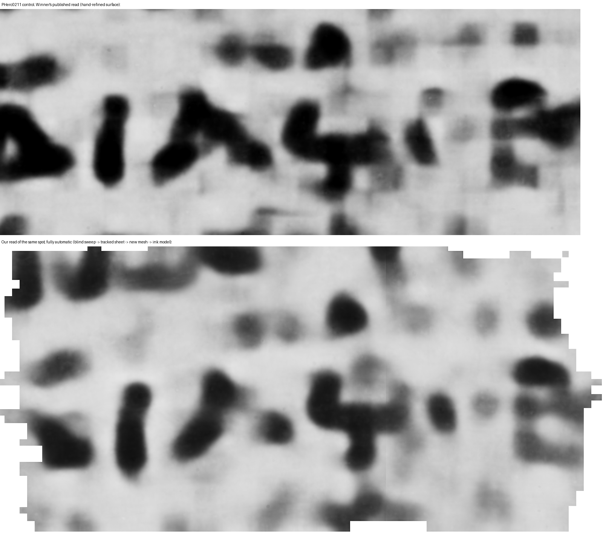
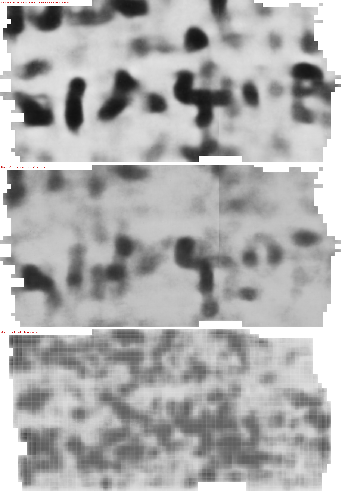
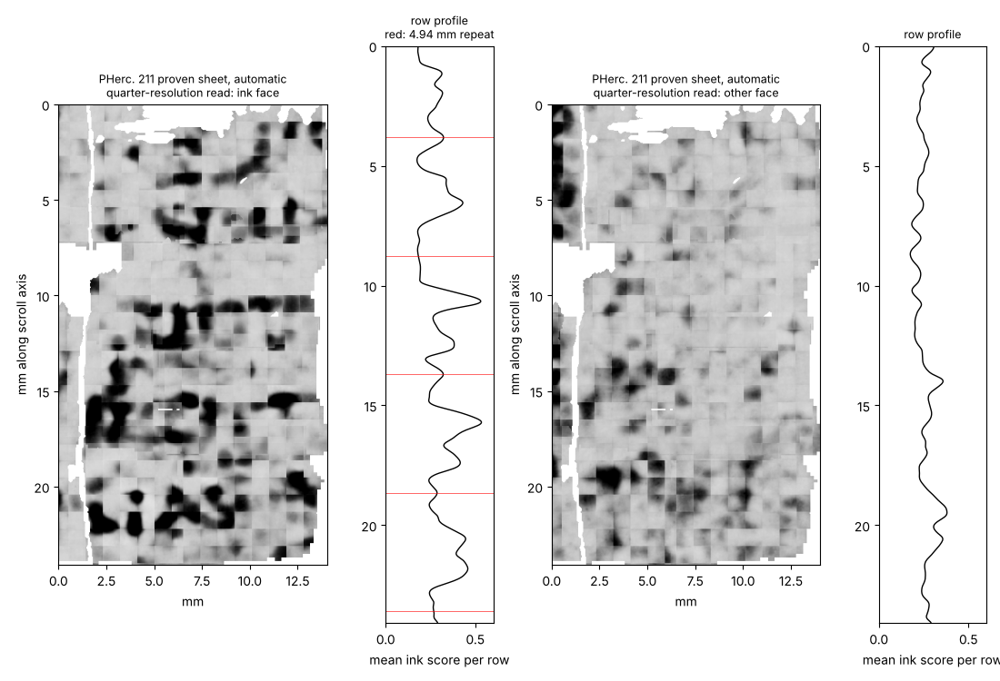

# Automatic unstretched re-meshing of tracked papyrus sheets, scored against a prize-winning read

`tools9.py remesh` turns an automatically tracked papyrus sheet in a 9 µm scan into a clean tifxyz mesh with no hand
work. Read with the public ink models, that mesh gets about **90% of the way to a hand-refined surface**, measured
against the published PHerc. 211 First Letters result (Priyank Aranke, 15 Nov 2026).

| Surface (PHerc. 211, scan `20250821151803`) | Studio soft-loss | Reader V3 | v8-in |
|---|---|---|---|
| Winner's hand-refined mesh, through our code | 0.97 | 0.71 | 0.50 |
| **Our automatic re-mesh, no hand work** | **0.90** | **0.62** | **0.44** |
| Automatic as a share of hand-refined | 93% | 88% | 88% |
| Same sheet before re-meshing (read on the tracking canvas) | 0.84 | – | – |
| Other face of our re-mesh | −0.19 | −0.13 | −0.23 |

Numbers are Pearson correlation with the winner's published Studio probability map inside his clearest-letter region
(0.76 cm², letters "ΔΙΑ…"). Reader V3 and v8-in are different models from the one that made the reference map, so their
ceiling is lower; the row that matters is the ratio.



*Top: the winner's published ink map (hand-refined surface, CC BY-NC 4.0, Priyank Aranke). Bottom: our read of the same
spot with no hand work: blind sweep → tracked sheet → automatic re-mesh → same ink model.*



*The same automatic mesh read by Studio soft-loss, Reader V3 and v8-in.*

## What is in the repository

| File | Purpose |
|---|---|
| `tools9.py` | `remesh`: tracked sheet → its own unstretched tifxyz mesh. `cmp`: score a read against a reference map |
| `meshcheck.py` | CPU-only report for any tifxyz: node spacing, shear, sharp bends, with a four-panel map |
| `sweep.py` | Tracks every sheet in a slab around a base mesh from the public surface predictions, then reads each with Studio soft-loss, TRACE, Reader V3 or v8-in |
| `slabtrack.py`, `geom.py`, `vol.py` | Sheet tracking, mesh geometry, chunked volume access |
| `mergeH.py`, `llsm.py` | Merge sheet pieces the tracker split; smoothing of height fields with holes |
| `stack.py` | Depth-stack summary and contact sheet |
| `lines/` | Match sheets across z-bands, stitch strips, text-line spacing rule |
| `linefind.py` | Single-line chain detector, our implementation of the method the PHerc. 306B team described |
| `setup4.sh` | Pod setup with pinned commits and sha256-checked weights |
| `reports/` | Dated reports and the criteria file written before the extension data |

Meshes are read and written as tifxyz (20 voxels per node, `x.tif`/`y.tif`/`z.tif` plus `meta.json`).

## How the re-mesh works

1. Rows are cross-sections of the tracked sheet at constant z, 20 voxels apart.
2. Columns are arclength along each cross-section. Lengths come from a lightly smoothed copy of the sheet, positions
   from a less smoothed one.
3. Each row is anchored at the foot of one anchor point, then squared up against the row before it by removing the
   median sideways slip.

On the control this gives node steps of 19.99 and 20.25 voxels and axes a median 2° off square. The tracked sheet itself
lies a median 1.1 voxels from the hand-refined surface (67% within 2 voxels, 78% within 3).

## What we measured on the way (PHerc. 211, Studio soft-loss)

| Step | Match |
|---|---|
| Our Studio inference on the winner's published 16-plane input | 0.988 |
| Our full chain (raw scan → render → Studio) on the winner's mesh | 0.974 |
| Winner's surface shifted along its normal by −4 / −2 / +2 / +4 voxels | 0.88 / 0.95 / 0.92 / 0.72 |
| Automatic sheet on the tracking canvas, with our depth-alignment step (`--flatten`) | 0.755 |
| Automatic sheet on the tracking canvas, without it | 0.842 |
| Winner's exact heights rendered through the canvas geometry | 0.85 |
| Automatic sheet, re-meshed | 0.90–0.91 |

- **Tracking is not the main loss; geometry is.** Reading on a stretched canvas with normals borrowed from the base mesh
  costs about 0.12. Re-meshing recovers about half of it.
- **Aligning each column's depth profile to its neighbours hurts** (0.842 → 0.755). Snapping a surface to the CT signal
  is not automatically an improvement for ink reading.
- **Depth tolerance is about ±2 voxels.** A constant +4 voxel error costs a quarter of the match.
- **Combining neighbouring depths does not sharpen the read.** Mean or maximum over ±3 or ±6 voxels moves Reader V3
  from 0.62 to 0.63–0.66 and leaves Studio unchanged or slightly lower.

## Controls

**Depth sweep.** The re-meshed sheet is read at offsets along its normal. Known ink fades in a fixed way:

| Offset (voxels) | Reader V3 dark % | Reader V3 match with depth 0 | Studio dark % | Studio match with depth 0 |
|---|---|---|---|---|
| 0 | 15.5 | 1.00 | 24.5 | 1.00 |
| ±3 | 14.0 / 12.2 | 0.96 / 0.94 | 17.4 / 25.9 | 0.94 / 0.92 |
| ±6 | 8.2 / 5.0 | 0.89 / 0.58 | 12.1 / 8.7 | 0.84 / 0.60 |
| ±9 | 0.8 / 0.7 | 0.59 / 0.08 | 3.4 / 1.6 | 0.49 / −0.02 |

**Shortcuts that failed on the known answer** (ink face against the other face of the same sheets):

| Shortcut | Ink face | Other face | Verdict |
|---|---|---|---|
| Letter-sized marks per cm² (quarter-resolution maps) | 9.0 | 11.2 | does not separate |
| Studio dark fraction (quarter-resolution maps) | 6.8% | 10.8% | does not separate |
| Agreement between Studio and TRACE (quarter resolution) | 0.44 | 0.40 | does not separate |
| Agreement between Studio and Reader V3 (full resolution, re-meshed) | 0.72 | 0.69 | does not separate |
| 3D ink model `scrollprize/ink_3d_dino_guided` on 9.362 µm blocks | −0.15 to 0.00 vs the letters | – | not usable at this resolution |

"A second model agrees" is the normal state on a blank face too.

**Text-line spacing.** Lines of writing repeat at a fixed spacing, so the row profile of an ink map should too. On the
winner's map the repeat is 5.0–5.6 mm in all 13 windows. On our quarter-resolution sweep the rule flags the
prize-winning sheet at 4.92–4.96 mm and no other of 42 stitched sheets, including six bands added after the criteria
were written down (`reports/PREREG_211_extension.md`, outcome: weak). It is specific, but it only fires where the read
is already nearly legible.



## Unread scroll

The same pipeline was run over all 75 public meshes of PHerc. 813 (scan `20250821151723`). It produced no readable
text. Tracked sheets cover 12–35% of a band, so the limit there is surface prediction and tracking. Images and
locations for unread scrolls are not included, in line with the First Letters rule on not publishing findings.

## Usage

Setup on a GPU machine with about 48 GB VRAM (one A40 was used throughout). The scripts expect the layout that
`setup4.sh` creates under `/workspace/s3`; set `R=/your/dir` for setup and pass `--root /your/dir` to `sweep.py` to
change it. Run the commands below from that directory with the repository files copied into it.

```bash
pip install -r requirements.txt
bash setup4.sh          # about a minute, ends with SETUP_OK
```

Check any tifxyz surface (CPU, seconds):

```bash
python3 meshcheck.py path/to/segment.tifxyz check.png
# prints node spacing, shear and bend percentiles and a one-line reading; check.png maps them
```

Track the sheets around a base mesh (about 3–5 minutes):

```bash
python3 sweep.py --scroll PHerc0211 --D 170 --tile 1024 --marg 64 --only z7920_w020 \
  --xrange 0:1024 --studio-stride 96 --models studio --studio-faces forward --out $PWD/out/p211
```

Re-mesh one tracked sheet (canvas 18 here) and read it on its surface with three models:

```bash
python3 tools9.py remesh pmesh/meshes/PHerc0211/z7920_w020 \
  out/p211/z7920_w020/canv.npz 18 wm211/r2_w000 592 2172 500 760 10 0
python3 sweep.py --scroll PHerc0211 --D 170 --tile 1024 --marg 64 --ds 1 \
  --meshdir $PWD/wm211 --only r2_w000 --base-only --studio-stride 48 --models studio,v3,v8 \
  --studio-faces forward,reverse --trace-faces forward,reverse --out $PWD/out/r211
# Studio "forward" is the ink face; Reader V3 and v8-in read ink in "reverse"
```

Score a read against the winner's published map:

```bash
python3 tools9.py cmp wm211/r2_w000 "out/r211/r2_w000/maps/c00_v3_reverse.png" \
  winner211_v9 winner211_v9/studiosoft_probability_f32.tif pair.png
# expected: clearest-letter region 0.62 (0.90 for c00_studio_forward.png)
```

Depth sweep:

```bash
python3 sweep.py ... --base-only --models v3,studio --studio-faces forward --trace-faces reverse \
  --koffs=-15,-12,-9,-6,-3,0,3,6,9,12,15 --out $PWD/out/k211
```

Line-spacing test on a quarter-resolution sweep:

```bash
export ROOT=$PWD/out/sweep MESHES=$PWD/pmesh/meshes     # sweep output and base meshes
python3 lines/st2.py PHerc0211 z6112_w020,z6720_w020,z7312_w020,z7920_w020 \
  studio_forward,studio_reverse st211.npz             # needs at least 3 consecutive z-bands
WD=250 COV=0.35 python3 lines/rule.py studio_forward,studio_reverse st211.npz
# expected: one HIT on the ink face, sheet z6112_w020_c18, spacing 4.94 mm; none on the other face
```

## Cost

About $17 of A40 time in total: about $13 for the first sweeps and about $3.50 for all controls and follow-ups. For
a 1 cm² sheet, both faces: Reader V3 about 4 seconds, Studio about 50 (stride 48), v8-in about 3 minutes (stride 21).

## Limits

- One known-answer scroll, and within it one proven sheet. The headline figures are one region of 0.76 cm².
- The re-mesh needs a tracked sheet from `sweep.py`, which depends on the public surface predictions and on an existing
  base mesh. It does not yet take an arbitrary tifxyz as input.
- `meshcheck.py` flags our own re-mesh for shear along its ragged edges (median 2°, 95th percentile 30°).
- The line-spacing rule was set after looking at the control; the pre-specified extension came out weak.
- No hand refinement was done anywhere. Letters on the control are partly legible, not at prize quality.

## Credits and licences

- Code in this repository: MIT, © 2026 Aviad (`aviad12g`). Figures contain model output on Vesuvius Challenge scan data
  and, in one case, the winner's map; they are CC BY-NC 4.0.
- "Studio soft-loss" ink model and its code: Priyank Aranke, `priyankaranke/vesuvius-studio-multiscroll-cpt`
  (code MIT, **weights CC BY-NC 4.0**). His PHerc. 211 mesh, model input and ink map are CC BY-NC 4.0 and are not
  redistributed here (download them from his release).
- Reader V3: Domenico Russo, `domenicor046/reader-v3` (MIT).
- v8-in: Youssef Nader, `YoussefMoNader/ink-8um-v8in` (MIT).
- TRACE weights `v3B_best.pth`: `Jashann/vesuvius-scrolling`.
- Reader loading code, the v8-in wrapper and an early control mesh: `SirProdigle/pherc0306b-first-letters`
  (Liam Warner and Nicola Bodill).
- Base meshes: `pscamillo/vesuvius-eligible-meshes`.
- `ScrollPrize/villa` for volume and model utilities; 3D ink model `scrollprize/ink_3d_dino_guided` (MIT).
- Scans and surface predictions: Vesuvius Challenge open data (CC BY-NC 4.0).

Related earlier work by the same author: `aviad12g/vesuvius-depth-order-control` (depth-order and cross-model
controls for 9 µm ink detection, September 2026).
